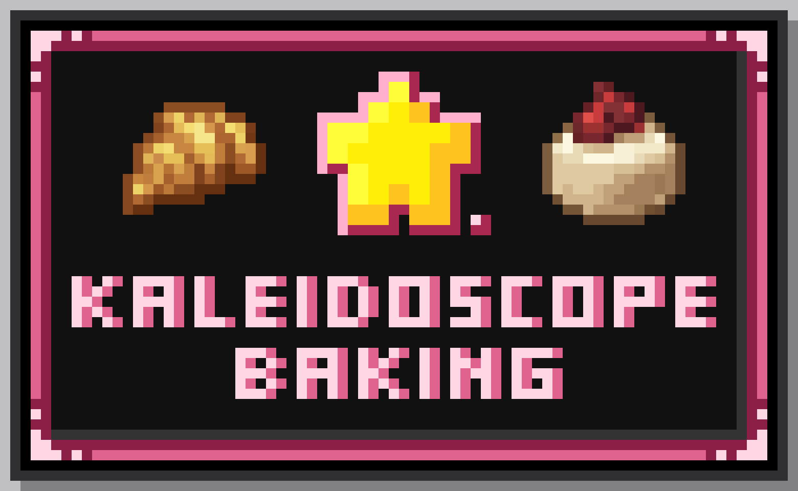

<p align="center"></p>

# Kaleidoscope-Baking
A Kaleidoscope series add-on introducing custom baking mechanics, new kitchenware, and delicious desserts

森羅物語：烘焙 —— 森羅物語：廚房（Kaleidoscope Cookery）的擴充模組：烘焙、甜點、咖啡館飲品與烘焙植物。

## 文件

- [企劃書 1.0（繁體中文）](docs/PROPOSAL.zh-TW.md)
- [企劃書 1.1（繁體中文）](docs/PROPOSAL-1.1.zh-TW.md)
- [玩法說明](docs/GAMEPLAY.zh-TW.md)
- [擴充 API（給其他模組作者）](BP/documentation/KB_EXTENSION_API.md)
- [美術資源清單（給美術，自動產生）](docs/ART_ASSETS.md)
- [腳本架構](BP/scripts/ARCHITECTURE.md)

## 內容（v1.2.2）

| 類別 | 數量 | 內容 |
|------|------|------|
| 站點 / 家具 | 12 | 烤箱（3×3×3）、攪拌盆、發酵籃、裱花台、咖啡機（紅石供電）、手沖架、雪克杯、香草盆栽、蛋糕架、三層點心架、麵包展示櫃、甜點櫥窗 |
| 工具 | 19 | 打蛋器、奶泡器、擠花袋、擀麵棍、麵包刀、9 種模具、馬克杯、外帶杯、空罐子、奶油罐、生日蠟燭 |
| 材料 | 98 | 麵團 / 麵糊、千層酥皮、6 色糖霜、果醬、醬料、咖啡豆（三焙度）、珍珠、茶湯底、鹹蛋黃、副產品（咖啡渣、果渣、麵包屑）… |
| 植物 | 32 | 香草蘭、迷迭香、百里香、薰衣草、薄荷、肉桂樹、芝麻、甜菊、樹薯、咖啡樹、草莓、藍莓、覆盆子、檸檬樹、鳳梨 |
| 烘焙美食 | 57 | 麵包、11 種可擺放的整顆蛋糕 / 派、千層酥皮點心、瑪德蓮、糖霜餅乾、蛋黃酥、鳳梨酥、馬拉糕、奶油濃湯、炸魚排… |
| 飲品 | 25 | 10 種馬克杯咖啡可放在地上（一格最多 4 杯）；手搖飲潛行放下（一格最多 4 杯，保留甜度 / 冰塊）… |

- 配方：烘焙站點 133 道，另向廚房站點註冊 60 道（含牛奶基底湯鍋、奶油罐入炒鍋）
- 廚房食譜書「烘焙」分頁（三語）；其他模組後來註冊的配方也會自動更新
- 咖啡因與心悸、下午茶加成（點心架 60 秒）、手搖飲甜度 / 冰塊、副產品
- 開放 API v1（1.1 新增：副產品、查詢食材、調整咖啡因、展示規則、公開甜點元件）
- 系列互通：裝了豐收時，草莓、藍莓、檸檬、鳳梨以豐收的版本為主；兩邊重複的水果製品以豐收為準、乳製品與蛋製品以樂牧為準，站點兩種都收，發酵籃可一對一互換；裝了漁歌時麵包屑可以當魚餌；裝了樂牧時果渣可以放進飼槽餵豬和兔子

方塊模型與方塊貼圖由 `tools/art/` 以程式繪製（含 z-fight 稽核、單面材質），物品圖示由 Retro Diffusion 產生；說明見 [tools/art/README.md](tools/art/README.md)，預覽在 `art/previews/`。

## 開發

需要 Node.js 22+ 與 Python 3（含 Pillow）。

```sh
npm test                           # 83 項測試：純邏輯 + 以模擬 @minecraft/server 實際執行所有方塊腳本
python3 tools/validate.py          # 檢查 JSON、貼圖、語系、物品 ID、元件註冊、腳本語法、不顯示文字
python3 tools/check_rp.py          # 實體 / 動畫 / 算圖控制器 / 粒子 / 動態貼圖互相對得上，腳本設定的實體屬性在範圍內
python3 tools/art/check_refs.py    # 每個方塊的模型、貼圖、UV 都對得上
python3 tools/build.py             # 打包成 dist/Kaleidoscope-Baking-v<版本>.mcaddon
python3 tools/gen_content.py       # 由 tools/content.py 產生物品 / 方塊 / 語系 / 暫代圖（不覆蓋既有圖）
node tools/gen_oven_block.mjs      # 修改烤箱結構後重新產生 BP/blocks/oven.json
```

安裝：匯入 `.mcaddon` 後，在世界中同時啟用 **森羅物語：廚房 v1.6.6** 與 **森羅物語：烘焙**；不需要開啟 Beta API（只使用穩定版 `@minecraft/server` 2.7.0 與 `@minecraft/server-ui` 2.0.0）。
